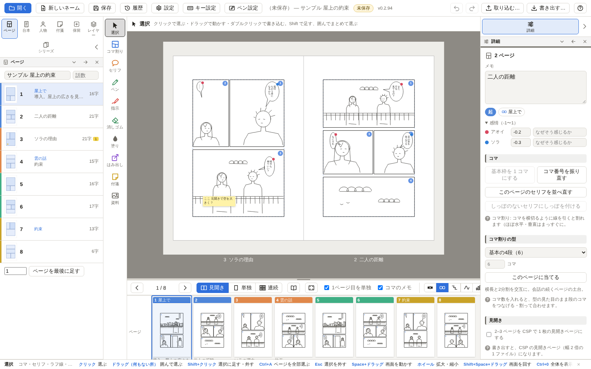
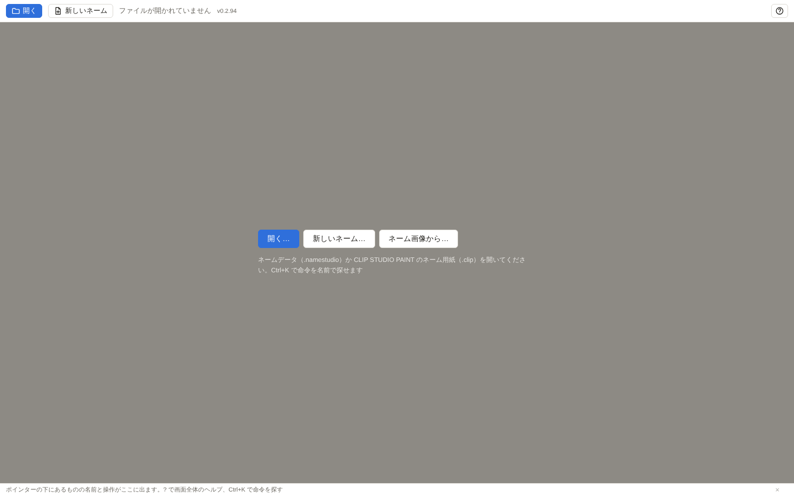
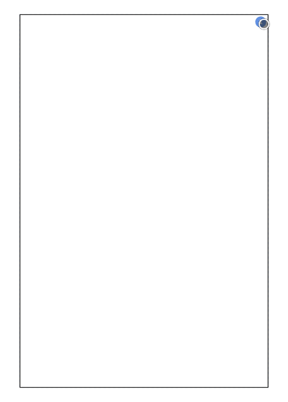
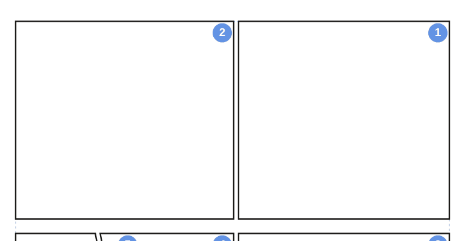
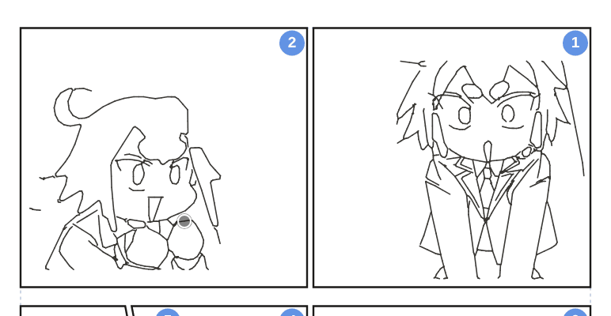
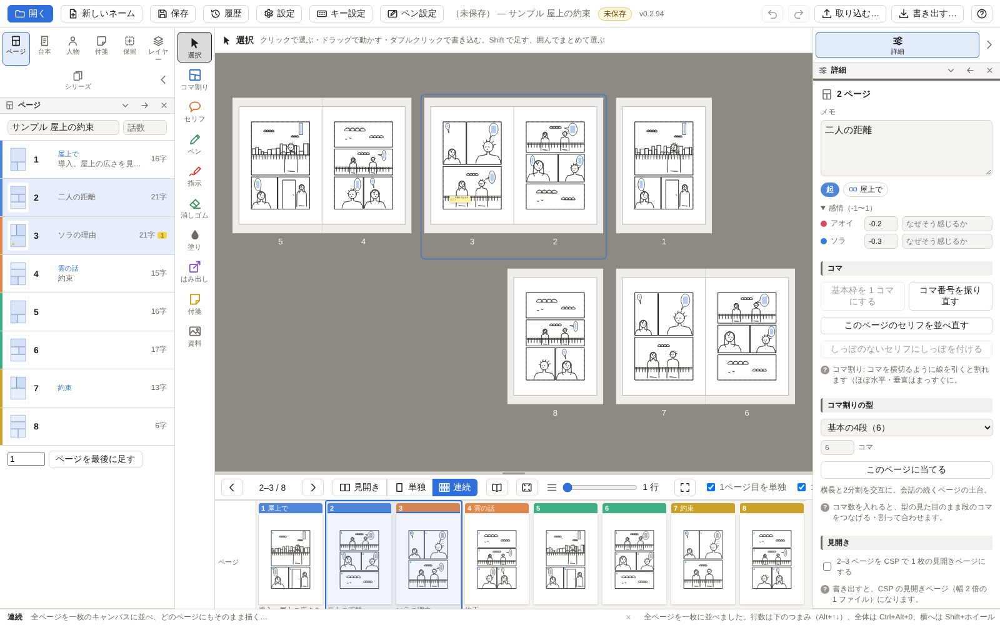
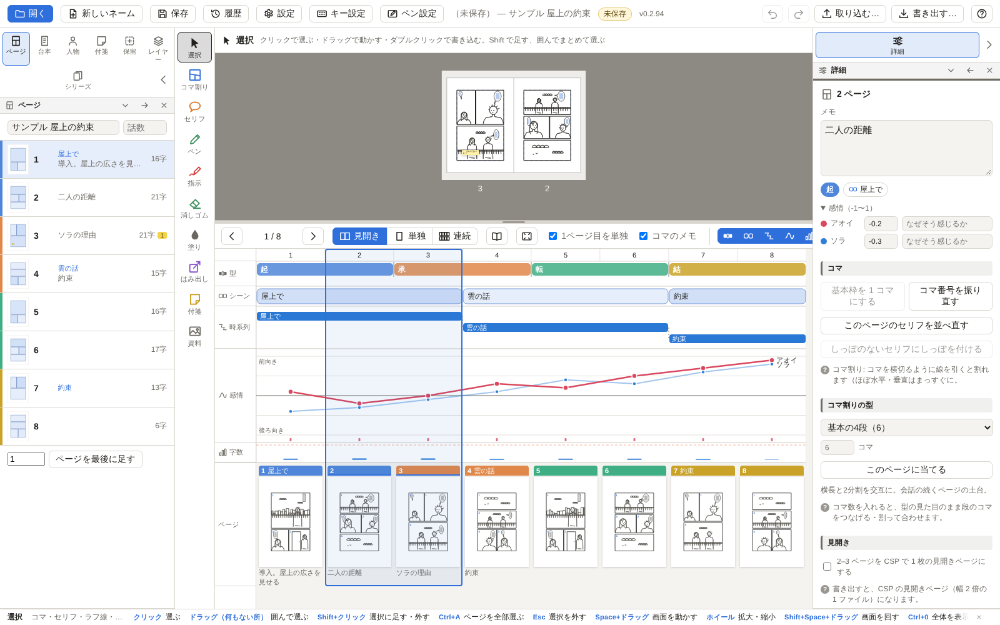
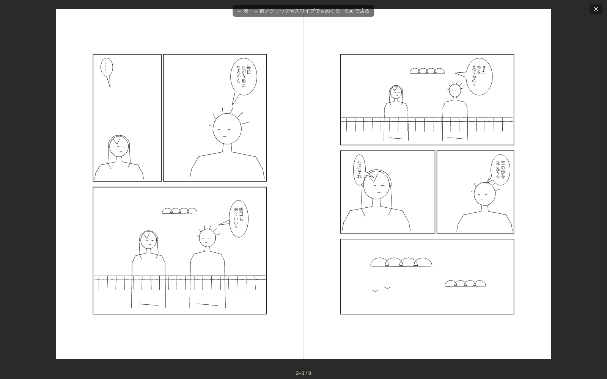
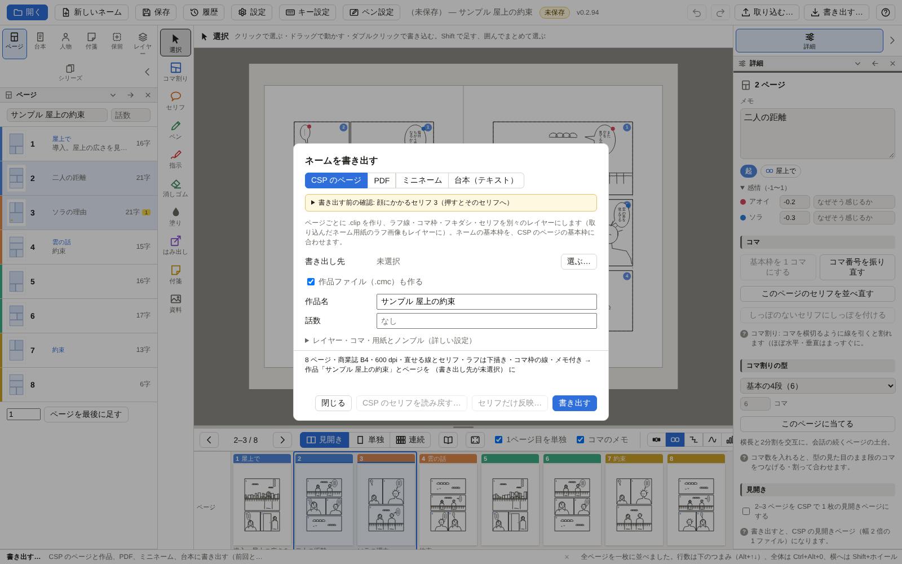

# Name Studio

**ネーム（漫画の絵コンテ）を描くためのアプリです。** コマを割り、ラフを描き、セリフを置いて、
できたネームを CLIP STUDIO PAINT（CSP）の作品とページにそのまま書き出せます。ペン入れからは今までどおり CSP で。

*A Windows app for drawing manga storyboards (ネーム) that writes them out as CLIP STUDIO PAINT pages and works. The app is in Japanese.*

## できること

- **コマ割りは線を引くだけ。** 横切るように引くと間白つきで割れます。斜めも、型から一度に割るのも、なぐり描きの仮のコマも
- **セリフはクリックして打つだけ。** フキダシが文字に合わせて伸び縮みし、しっぽは話している人へ向きます。縦書き・横書き、モノローグやナレーションも
- **ラフは筆圧つきのペンで。** ペンタブレットの筆圧・傾き・消しゴム側に対応。資料の画像を下に敷いても描けます
- **全体を見ながら描ける。** 全ページを一枚に並べる「連続」、本としてめくる「読む」、シーン・感情の流れ・字数が見える物語の帯
- **CSP にそのまま渡せる。** ページごとの .clip と作品の .cmc を作ります。ラフ・コマ枠・フキダシ・セリフはレイヤーに分かれ、線とセリフは CSP で直せるまま
- **ペン入れのあとも行き来できる。** ネームで直したセリフだけを CSP のページへ反映、CSP で直したセリフをネームへ読み戻し
- **打ち合わせにも。** PDF、全ページを 1 枚にしたミニネーム、台本のテキストにも書き出せます
- **作業は消えない。** 自動で保存し、版の履歴から前の状態に戻せます。落ちても次の起動で復元できます

CSP 本体には手を入れず、.clip / .cmc ファイルを読み書きするだけで CSP とつながります。

## はじめかた

1. [最新のリリース](https://github.com/nanikasheila/name-studio/releases/latest) から `NameStudio_…_x64-setup.exe` を落として入れます（Windows 10 / 11）。
   署名していないので、初回は SmartScreen の「詳細情報 → 実行」で進めます。
2. 起動して「新しいネーム」（白紙から）か「開く」（CSP のネーム用紙 .clip や、前に作ったネーム .namestudio）。
   紙に描いたネームの写真やスキャンから始める「ネーム画像から…」もあります。

入れたあとは、起動するたびに新しい版を確かめて自動で更新します（ネームを開いているときは右上の「更新」を押したときに）。
自動で入れるか、知らせるだけにするか、確かめないかは、設定（歯車）→「この PC」→「更新」で選べます。
新しい機能を早く試したいときは同じ所で「試験版も受け取る」に。困ったら「前の版に戻す」で戻せます。

## 使い方の流れ

### 1. コマを割る

左の「コマ割り」（K）で、コマを横切るように線を引きます。ほぼ水平・垂直の線はまっすぐに、斜めはそのまま。
境目（間白）をドラッグして動かす、角を動かす、隣のコマとつなぐ、型（基本の 4 段など）を当てることもできます。

### 2. ラフを描く

「ペン」（P）で描きます。Shift を押しながら引くと直線、ペンの消しゴム側か「消しゴム」で消せます。
ラフ線は「人物」「背景」のようにレイヤーに分けられ、CSP へは下描きレイヤーで渡ります。

### 3. セリフを置く

「セリフ」（T）でコマの中をクリックして、そのまま打ちます（Ctrl+Enter で決定、Tab で次のセリフへ）。
フキダシは文字に合わせて大きさが変わり、「しっぽを付ける」で話している人の方へしっぽが向きます。

### 4. 全体を見直す

ページの下の「連続」で全ページを一枚のキャンバスに並べ、どのページにもそのまま描けます。

物語の帯（F6 で大きく）には、話の型（起承転結など）・シーン・時系列・人物ごとの感情の流れ・ページごとの字数が並びます。
シーンやページを押すとそこへ移り、帯の上でシーンの範囲や感情の値を直せます。

「読む」（F5）では、道具や付箋を消して本のようにめくって読めます。

### 5. CSP へ書き出す

右上の「書き出す…」で書き出し先を選んで「書き出す」。ページごとの .clip と作品ファイル（.cmc）ができるので、
CLIP STUDIO PAINT EX で作品を開いてペン入れに進みます。用紙（商業誌 B4 など）・解像度・ノンブルは書き出し画面で決められ、
CSP のひな形がなくても書き出せます。書き出す前に、顔にかかるセリフやコマの外のセリフなどを知らせてくれます。

同じ画面から PDF・ミニネーム（全ページを 1 枚に）・台本（テキスト）にも書き出せます。
ペン入れを始めたあとで台本を直したときは「セリフだけ反映…」で、描いたレイヤーはそのままにセリフとフキダシだけを入れ替えます。
CSP の方でセリフを直したときは「CSP のセリフを読み戻す…」でネームに入れられます。

## 困ったとき

- **Ctrl+K**（命令パレット）でやりたいことを打つと、命令が見つかります
- 窓の下の**ヘルプの帯**に、ポインターの下にあるものの名前と、マウス・キーでできることが出ます
- 右上の **?** で、画面の各部の名前と使い方が出ます
- 書いている途中で閉じても、次に起動したときに復元するか聞かれます。版の履歴（上の「履歴」）から前の状態にも戻せます

機能ごとの詳しい説明は [使い方のくわしい説明](docs/guide.md) にあります。
不具合や要望は [Issues](https://github.com/nanikasheila/name-studio/issues) へどうぞ。

## ライセンス

Name Studio は [GNU General Public License v3.0 以降](LICENSE)（GPL-3.0-or-later）の自由ソフトウェアです。
だれでも使う・調べる・直す・配ることができます。直したものや、組み込んだものを配るときは、それも同じライセンスでソースコードと一緒に配ってください。
GPL に変える前（2026 年 10 月 28 日まで）に公開した版は MIT ライセンスで、その版は MIT のまま使えます。

Copyright © 2026 nanikasheila

組み込んでいるライブラリとそのライセンスは [THIRD_PARTY_NOTICES.md](THIRD_PARTY_NOTICES.md)（インストール先にも入ります）。
CLIP STUDIO PAINT は株式会社セルシスの製品で、このアプリはセルシスとは関係のない個人の作ったものです。

## 開発に参加する

ビルドのしかた、構成、テスト、リリースの手順は [開発のしかた](docs/DEVELOPMENT.md) にあります。
